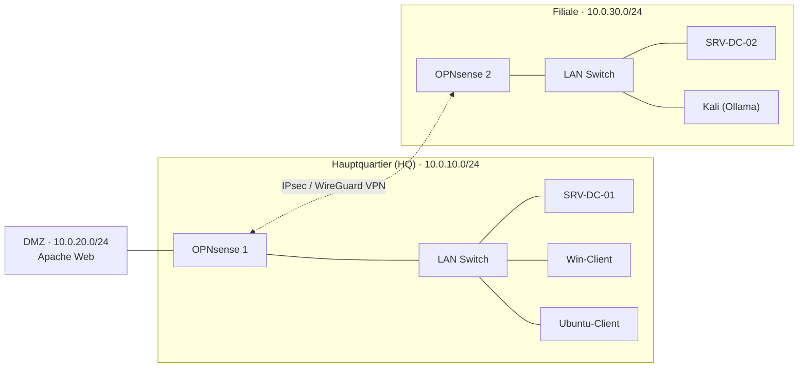

# 0.1 Topologie-Design

## Architektonischer Netzplan

Dieses Dokument visualisiert die grundlegende Netzwerktopologie für das Projekt „Hybrid Cloud & AI-Sec Operations“. Gemäß den Vorgaben wurde das Netzwerk in zwei physische Standorte unterteilt.

## Ressourcen-Zuteilung laut Projektplan

- **Host 1 (HQ):** 4TB SSD, 40GB RAM. Beherbergt primäre Infrastruktur und DMZ.
- **Host 2 (Filiale):** 2TB SSD, 40GB RAM. Fokus auf KI-Log-Analyse und redundante Authentifizierung.

---
[Modulübersicht](README.md) · [0.2 →](0.2-namenskonvention.md)
